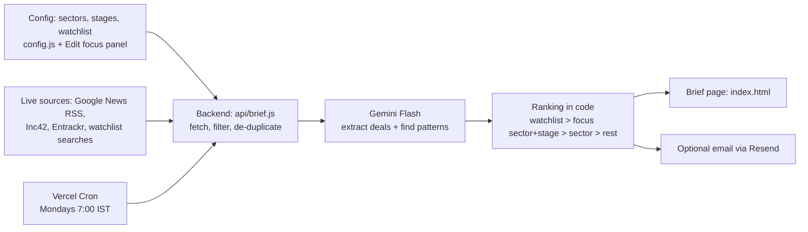

# Funding Pulse

A weekly AI brief of Indian startup funding activity for a venture scout. Built with live news feeds, Gemini Flash, and Vercel.

## Components map

## Files

| File | What it does |
|---|---|
| `index.html` | The brief page Aarav opens |
| `api/brief.js` | Fetches news, calls Gemini, ranks deals, returns the brief |
| `config.js` | Default focus sectors, stages, and watchlist |
| `vercel.json` | Monday-morning schedule and function timeout |

## Environment variables (set in Vercel, never in code)

| Name | Required | Purpose |
|---|---|---|
| `GEMINI_API_KEY` | Yes | Gemini Flash access (free key from aistudio.google.com) |
| `RESEND_API_KEY` | No | Email the brief on Monday mornings |
| `BRIEF_EMAIL_TO` | No | Email address(es) to receive the brief |
| `CRON_SECRET` | No | Only lets Vercel's scheduler trigger the email |

## Human checkpoint

AI extracts amounts and investors from headlines, so every deal links to its source. Aarav verifies figures before acting on them or sharing with LPs. Watchlist matching is done in plain code, not by the AI.
